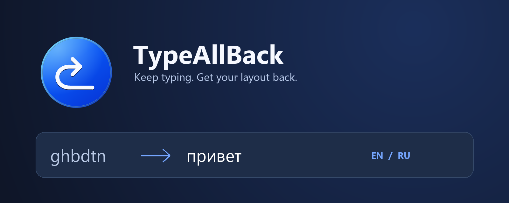

<p align="center">
  
</p>

<p align="center">
  <a href="https://github.com/HeyOkay/TypeAllBack/releases/latest"></a>
  
  <a href="https://github.com/HeyOkay/TypeAllBack/actions/workflows/ci.yml"></a>
  <a href="LICENSE"></a>
</p>

<p align="center">
  <strong>Набрали текст не в той раскладке? Верните его одним действием.</strong><br>
  TypeAllBack показывает исправленный вариант рядом с курсором и помогает исправить текст перед отправкой.
</p>

<p align="center">
  <a href="https://github.com/HeyOkay/TypeAllBack/releases/latest"><strong>Скачать для Windows</strong></a>
  · <a href="INSTALLING.md">Установка</a>
  · <a href="https://github.com/HeyOkay/TypeAllBack/issues">Сообщить о проблеме</a>
</p>

## Как это работает

Вы печатаете как обычно. Если текст похож на ввод в неверной английской или русской раскладке, рядом появляется подсказка: `ghbdtn` → `привет` или `руддщ` → `hello`.

Примите подсказку стрелкой **→** или щелчком мыши. При включённом исправлении перед **Enter** приложение сначала исправит подтверждённый участок текста, проверит результат и затем передаст Enter в поле ввода. Эта опция включена по умолчанию; её можно отключить в трее.

## Возможности

- **Подсказка во время ввода.** Исправленный вариант появляется рядом с курсором.
- **Исправление перед Enter.** Помогает не отправить сообщение в неверной раскладке.
- **Сохранение остального текста.** Исправление относится к текущему отслеживаемому участку; ранее введённый текст сохраняется.
- **Работа в трее.** Пауза, звук исправления, автозапуск и настройки доступны в компактном меню.
- **Обновления внутри приложения.** Загрузка, проверка пакета, установка и перезапуск без перехода в браузер.
- **Отладка по запросу.** История ввода, подсказок и причин окончания сессий помогает разобраться в проблеме.

## Начать пользоваться

1. Скачайте файл **TypeAllBack-…-win-x64.msi** из [последнего выпуска](https://github.com/HeyOkay/TypeAllBack/releases/latest).
2. Установите приложение и запустите **TypeAllBack** из меню «Пуск».
3. Наберите `ghbdtn` в поддерживаемом поле, дождитесь подсказки и нажмите **→**.

Нужна Windows 10 или 11, x64. Установка выполняется для текущего пользователя; отдельно устанавливать .NET не требуется. Подробности — в [инструкции по установке](INSTALLING.md).

| Действие | Управление |
| :--- | :--- |
| Принять видимую подсказку | **→** или щелчок по подсказке |
| Исправить перед Enter | **Enter**, если опция включена и подсказка подтверждена |
| Обычный Shift+Enter | **Shift+Enter** сохраняет поведение поля |
| Открыть отладку | **Ctrl+Alt+F12** или меню трея |
| Приостановить утилиту | Переключатель «Утилита включена» в трее |

Без подходящей подсказки стрелка и Enter работают обычно. Пробел не принимает подсказку. Назначение Enter — отправка сообщения или новая строка — определяется самим приложением, в котором вы печатаете.

## Локальная обработка

Распознавание раскладки выполняется на компьютере. Введённый текст не отправляется на сервер и не используется для обучения модели. Сетевые запросы нужны для проверки и загрузки обновлений с GitHub. Автоматическую проверку можно отключить в трее.

Отладочное окно показывает набранный текст: проверяйте его содержимое перед публикацией скопированного лога.

## Текущее состояние

TypeAllBack находится на стадии предварительных выпусков. Пользовательские проверки пройдены в Блокноте, адресной строке Chrome, ChatGPT Desktop и Discord. Поддержка зависит от того, какие сведения о тексте и курсоре предоставляет поле ввода.

В некоторых полях шрифт подсказки может отличаться от исходного. Короткие и неоднозначные слова распознаются не всегда. Если состояние текста нельзя безопасно подтвердить, исправление не выполняется; при попытке исправления перед Enter отправка может быть отменена с причиной в отладке.

Механизм обновления включает проверку размера и SHA-256 пакета. Для версии 0.1.3 проверены загрузка и запуск помощника обновления; полный цикл установки с перезапуском ещё требует проверки на установленном приложении.

## Разработка и документация

Приложение написано на C# / WPF, .NET 10. Для сборки нужен .NET 10 SDK на Windows:

```powershell
dotnet build .\LayoutPreviewPrototype.csproj -c Debug
dotnet run --project .\Tests\LayoutPreview.Tests.csproj -c Debug
```

Название основного файла проекта сохранено от прототипа LayoutPreview.

- [Установка, обновления и сборка MSI](INSTALLING.md)
- [Модели распознавания и источники данных](Models/README.md)
- [Проверки поведения](TEST-CHECKLIST.md)
- [Отчёт о производительности](PERFORMANCE-REPORT.md)
- [История разработки и обратная связь](DEVELOPMENT-NOTES.md)
- [Архив описания прототипа](docs/PROTOTYPE-HISTORY.md)

## Лицензия

Собственный код распространяется по [PolyForm Noncommercial 1.0.0](LICENSE). Коммерческое использование требует предварительного письменного разрешения правообладателя **HeyOkay**.

Данные моделей имеют отдельную лицензию **CC BY-SA 4.0**. Условия и исключения описаны в [LICENSING.md](LICENSING.md) и [документации моделей](Models/README.md).
